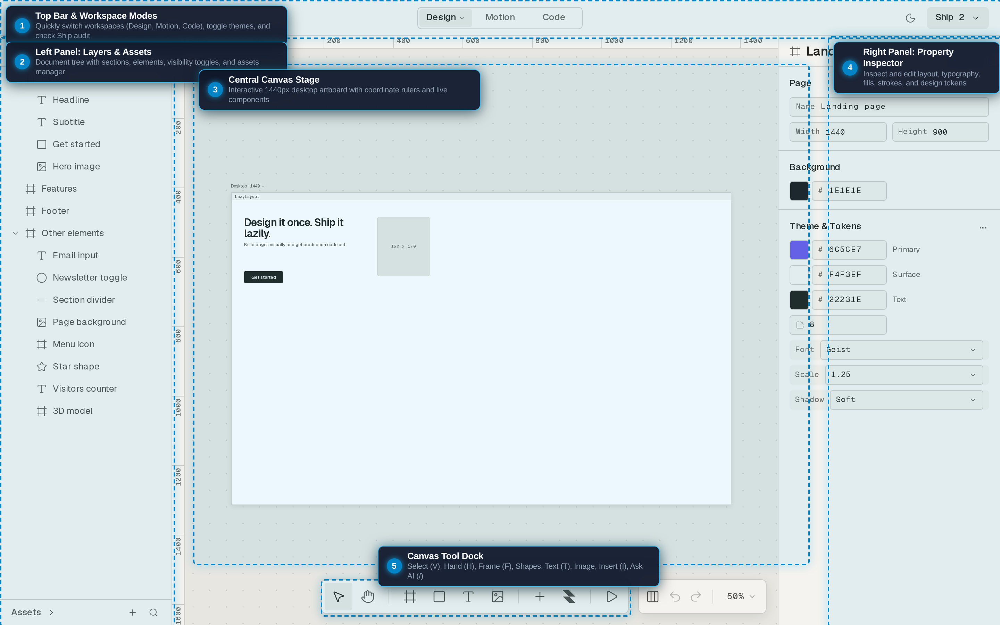
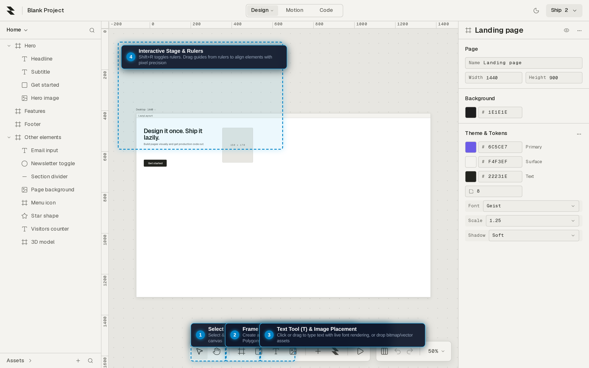
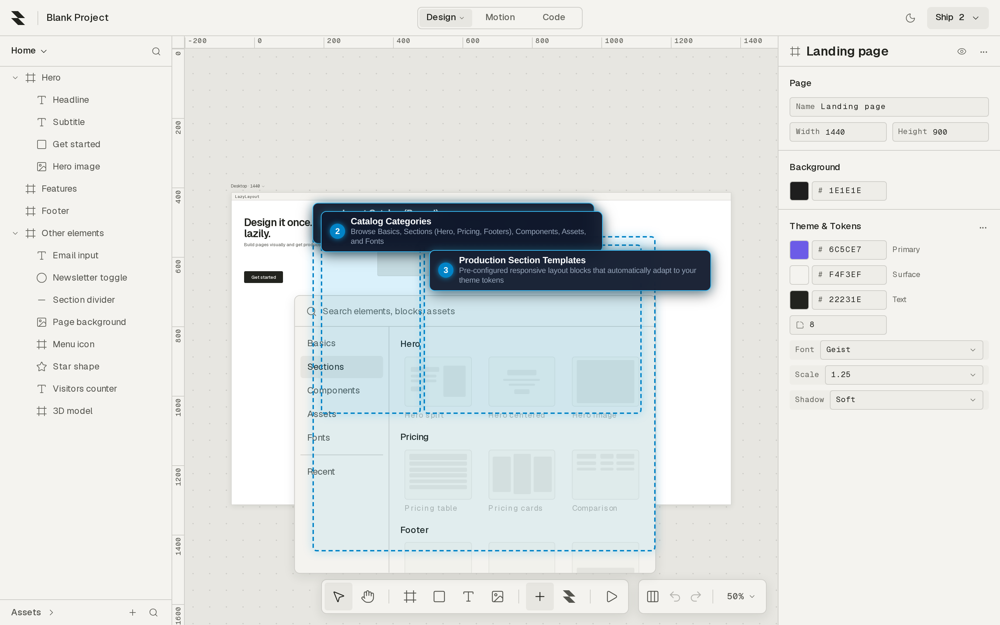
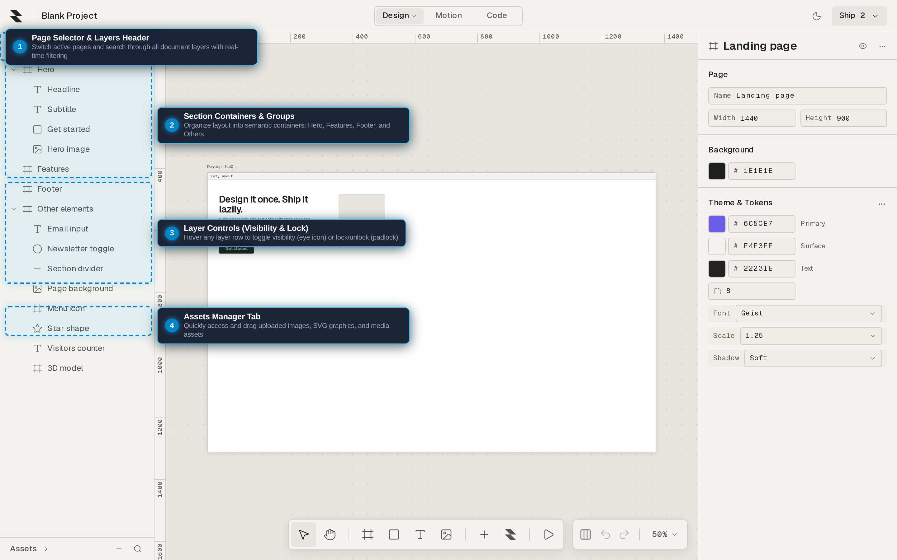
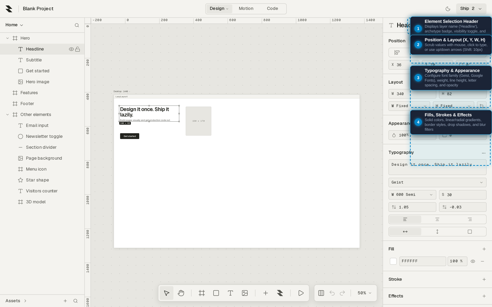
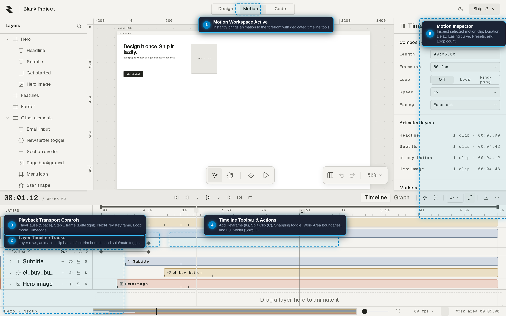
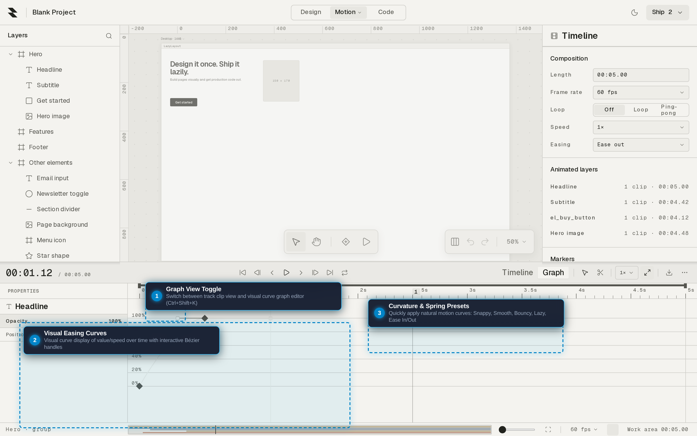
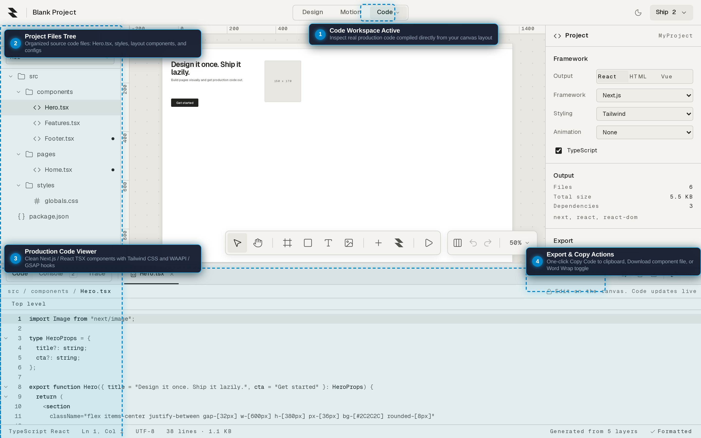
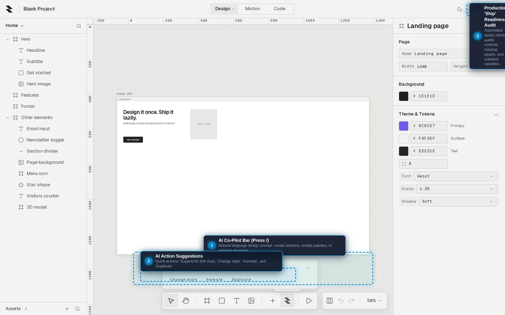
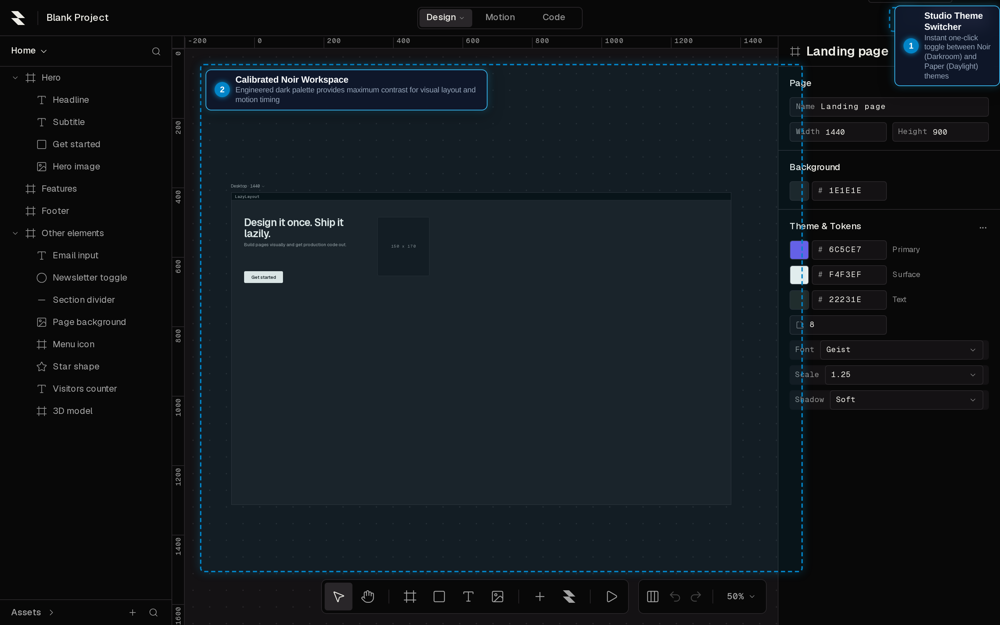

# LazyLayout: The Complete User Manual

Welcome to **LazyLayout**, an AI-native visual design and animation studio for the modern web.

In LazyLayout, **motion is not an afterthought—it is a core primitive of the design itself**. You compose responsive layouts on an infinite canvas, choreograph fluid animations along an integrated timeline, and inspect or export production-ready code in real time (**Next.js / React 19**, **Tailwind CSS**, and **WAAPI / GSAP**).

This manual is crafted for **first-time users, designers, and developers** alike. Whether you have never used an animation studio before or are transitioning from Figma, After Effects, or Webflow, this guide will take you step-by-step through every feature, workflow, and capability available today.

---

## Table of Contents

1. [Feature Status Matrix: What is Built vs. What is Not Built Yet](#1-feature-status-matrix-what-is-built-vs-what-is-not-built-yet)
2. [Quickstart: Launching the Studio](#2-quickstart-launching-the-studio)
3. [Studio Architecture: Tour of the 5 Core Zones](#3-studio-architecture-tour-of-the-5-core-zones)
4. [Drawing & Canvas Tools: Creating Shapes & Text](#4-drawing--canvas-tools-creating-shapes--text)
5. [The Insert Catalog: Pre-Built Sections & Primitives](#5-the-insert-catalog-pre-built-sections--primitives)
6. [Selection, Transformation & Layout Organization](#6-selection-transformation--layout-organization)
7. [Visual Styling: Fills, Gradients, Strokes & Effects](#7-visual-styling-fills-gradients-strokes--effects)
8. [Layers Hierarchy & Asset Management](#8-layers-hierarchy--asset-management)
9. [The Motion Studio: Keyframes, Timing & Playback](#9-the-motion-studio-keyframes-timing--playback)
10. [The Graph Editor: Bézier Curves & Spring Physics](#10-the-graph-editor-bézier-curves--spring-physics)
11. [Developer Mode: Production Code Generation & Export](#11-developer-mode-production-code-generation--export)
12. [AI Co-Pilot & The Command Palette](#12-ai-co-pilot--the-command-palette)
13. [Themes & Viewport Settings](#13-themes--viewport-settings)
14. [Complete Keyboard Shortcuts Reference](#14-complete-keyboard-shortcuts-reference)
15. [Troubleshooting & Frequently Asked Questions](#15-troubleshooting--frequently-asked-questions)
16. [Roadmap & Planned Capabilities](#16-roadmap--planned-capabilities)

---

## 1. Feature Status Matrix: What is Built vs. What is Not Built Yet

To save you time and avoid guesswork, the table below provides an honest, clear breakdown of what is fully functional in the software today versus what is currently in active development or planned on our roadmap.

| Feature Area | Built & Fully Usable Today | In Progress / Not Built Yet (Roadmap) |
|---|---|---|
| **Studio Workspaces** | Instant switching between **Design**, **Motion**, and **Code** workspaces via the top bar without reloading. Resizable and collapsible side panels (`Ctrl+\`). | Workspace layout custom drag-and-drop tear-off docks (in development). |
| **Canvas & Stage** | Infinite panning (`Space` or Hand tool `H`), zoom from 2% to 6,400% (`Ctrl+Scroll`, Fit to Screen `Ctrl+1`, Zoom 100%), smart snap guides, distance meters (`Alt`), and coordinate rulers (`Shift+R`). | Custom user-defined grid presets (current grid offers standard lines and dots). |
| **Drawing Primitives** | Artboard Frames (`F`), Rectangles (`R`), Ellipses/Circles (`O`), Lines (`L`), Arrows (`Shift+L`), Polygons (`Y`), Stars (`Shift+Y`), and in-place Text editing (`T`). | Pen tool vector node editing and Boolean shape operations (Union/Subtract/Intersect) are available in `/editor/legacy` and merging into the new UI in Phase 43. |
| **Insert Catalog** | Press `I` to open the Insert Catalog dialog: instant one-click placement of pre-built responsive sections (Hero, Pricing, Footers), UI primitives, buttons, and inputs. | Custom team component library publishing to a shared cloud registry. |
| **Transform & Arrange** | 8-point bounding box with live resize, 360° rotation handle, corner radius handles, drag marquee multi-selection, alignment bar (`Alt+A/H/D/W/V/S`), distribute (`Ctrl+Alt+H/V`), and Tidy Up (`Ctrl+Alt+T`). | Freeform skew / 3D tilt canvas gizmo. |
| **Styling & Inspector** | Live property inspector with **Position (X, Y, W, H, Rotation)**, **Appearance (Opacity, Corner Radius)**, solid fills, linear/radial gradients with on-canvas stop controls, image fills (Fill/Fit/Crop/Tile), strokes, drop shadows, inner shadows, and layer/background blurs. | Color variable alias linking across external design token tokensets. |
| **Typography** | In-place text editing, live Google Fonts and Geist font rendering, font family search, weight, line-height, letter-spacing, text alignment, and text transform. | Variable font optical axes sliders (planned in typography update). |
| **Layer Management** | Hierarchical document tree, section grouping (`Ctrl+G`), ungrouping (`Ctrl+Shift+G`), wrap in frame (`Ctrl+Alt+G`), layer renaming (`F2`), visibility toggle (eye icon), lock toggle (padlock icon), real-time layer search filter, and Assets manager tab. | Multi-layer batch renaming with regex tokens. |
| **Motion Timeline** | Dedicated bottom timeline drawer in Motion mode: layer tracks, animated clip bars, trim in/out points, playhead needle, timecode display (`MM:SS.FF`), transport controls (Play/Pause, Step 1 frame forward/backward, Jump keyframes, Loop toggle), stopwatch property animators, and work area boundaries. | Dedicated audio waveform sync track (planned). |
| **Graph Editor** | Interactive curve editor (`Ctrl+Shift+K` or "Graph" tab in timeline): visual value/speed curves with Bézier control tangent handles and instant Motion Feel presets (**Snappy**, **Smooth**, **Bouncy**, **Lazy**, Ease In/Out, Overshoot). | Multi-property simultaneous graph overlay comparison. |
| **Spatial Motion Paths** | Mathematical flight trajectory integration with Catmull-Rom and arc-length parameterization (Phase 69 engine). | On-canvas interactive dragging of Bézier tangent handles directly over the stage (Phase 69 Milestones 3–6 in progress). |
| **Code Generation** | Real-time bidirectional code generation: **Next.js / React 19 functional TSX components**, **Tailwind CSS classes**, semantic HTML5/CSS, and **WAAPI / GSAP motion hooks**. Built-in code viewer with syntax highlighting, line folding, Word Wrap, and one-click "Copy File" and "Download File". | Full two-way code-to-design AST round-tripping (changes currently flow visual canvas → production code). |
| **Export Options** | Download single component files, export project state (`.lazy.json`), import project files, and export full production packages via **File → Export Static Site / Zip**. | Direct one-click Vercel deployment button (planned). |
| **AI Co-Pilot** | Floating AI prompt bar (`/`) for natural language layout creation, color restyling, animation generation, and quick duplicate actions. Full AI chat view in right panel. | Multi-turn automated website generation from external Figma URLs. |
| **Production Audit** | "Ship" readiness check badge in top bar: audits design accessibility, contrast issues, and unlinked variables before shipping. | Automated lighthouse performance scoring inside the editor. |
| **Studio Themes** | Noir (Darkroom dark theme) and Paper (Daylight light theme) with instant one-click toggle. | Custom user-authored syntax and editor color themes. |
| **Persistence & Safety** | Automatic browser persistence (IndexedDB & LocalStorage), multi-tab conflict protection (second tab opens read-only with an "Edit here instead" takeover button). | Cloud multi-user real-time collaboration server (presence UI exists; local offline engine active). |

---

## 2. Quickstart: Launching the Studio

### Step 1: Open the Studio
Navigate to **`/editor`** in your browser. This is the primary, production-ready design studio workspace.

> [!TIP]
> **Bookmark your project address:** LazyLayout automatically persists your project in your browser's local database. When working on a project, your browser URL will include your project identifier (e.g., `/editor?projectId=...`). Bookmark this URL to return to your exact canvas state at any time.

### Step 2: The Default Showcase Prototype
When you first open `/editor`, LazyLayout automatically seeds a live showcase prototype into your canvas so you never face a blank white screen. You will see:
- A responsive **Hero Section** with a main headline (*"Design it once. Ship it lazily."*), a subtitle, a *"Get started"* primary button, and a hero image card.
- A **Features Section** structured with responsive feature cards.
- A **Footer Section**.
- An **Other Elements** group containing interactive inputs, toggles, badges, and shapes.

Feel free to click, drag, resize, or delete these elements as you learn the software!

---

## 3. Studio Architecture: Tour of the 5 Core Zones

The LazyLayout workspace is engineered with a clean, low-clutter interface divided into **five primary zones**:

### Zone 1: The Top Bar
Located along the very top of your screen, the Top Bar manages project-level state and global modes:
1. **Application Menu (`Saved` Logo Mark):** Click the logo in the top-left corner to access **File** (New, Open, Import, Export `.lazy.json`, Export Static Site Zip), **Edit** (Undo, Redo, Cut, Copy, Paste), **View** (Rulers, Grid, Snapping), **Window**, **Theme**, and **Help**.
2. **Project Title & Status:** Displays the active project name (e.g., *Blank Project*) and indicates when all changes have been saved to local storage.
3. **Workspace Mode Switcher:** Three dedicated buttons:
   - **`Design` Mode:** Focused on visual layout, typography, shapes, and styling. The timeline is hidden.
   - **`Motion` Mode:** Opens the bottom **Layer Timeline drawer** and displays animation properties in the right panel.
   - **`Code` Mode:** Opens the **Production Code Viewer** and component file tree to inspect or export React TSX, Tailwind, and GSAP code.
4. **Theme Switcher:** Click the theme button (moon/sun icon) to instantly toggle between **Noir (Dark)** and **Paper (Light)** themes.
5. **Ship Readiness Audit Button:** Located on the far right. Displays the number of items needing attention before export (e.g., *"Ship · 2 to fix"*). Clicking it reveals an automated diagnostic audit.

### Zone 2: The Left Panel (Layers & Assets)
The Left Panel manages your document structure:
- **Page Selector & Search:** Switch between active canvas pages (e.g., *Home*) or click the search icon to instantly filter layers by name.
- **Layers Hierarchy Tree:** Displays all frames, sections, and elements in back-to-front rendering order. Clicking any layer in this tree selects it on the stage, and selecting an element on the stage automatically reveals it in the tree.
- **Layer Actions:** Hovering over any layer reveals an **Eye icon** (toggle visibility) and a **Lock icon** (prevent accidental movement).
- **Assets Tab:** Located at the bottom of the tree. Click **Assets** to view your uploaded media, upload new PNG/JPEG/SVG files, or drag assets directly onto your canvas.

### Zone 3: The Central Canvas Stage
The infinite creative viewport where your design lives:
- **Artboard Frame:** The default workspace displays a standard **Desktop 1440px** artboard.
- **Coordinate Rulers:** Precision pixel rulers line the top and left edges. Press **`Shift+R`** to toggle rulers on or off. Drag down or inward from a ruler to drop custom guideline markers onto the canvas.
- **Interactive Transform Gizmo:** Selecting any object reveals an 8-point bounding box with handles for resizing, rotating, and corner rounding.

### Zone 4: The Right Panel (Property Inspector)
The Inspector adapts dynamically based on what you have selected:
- **When nothing is selected:** Displays **Page Settings** (artboard width, height, background color) and **Theme & Tokens** (primary brand color, surface colors, typography font family, scale factor, and shadow styles).
- **When an element is selected:** Displays detailed property controls: **Position (X, Y, W, H, Rotation)**, **Appearance (Opacity, Radius)**, **Typography** (for text elements), **Fills** (colors, gradients, images), **Strokes**, and **Effects** (shadows, blur).
- **In Motion Mode:** Displays motion parameters (duration, delay, easing curves, presets).
- **In Code Mode:** Displays component metadata and export targets.

### Zone 5: The Floating Canvas Tool Dock
Floating conveniently near the bottom of the canvas stage, the Tool Dock provides instant access to your creative instruments:
- **Select Tool (`V`):** The primary tool for selecting, dragging, and transforming objects.
- **Hand Tool (`H` or hold `Space`):** Click and drag to smoothly pan across the infinite canvas.
- **Frame Tool (`F`):** Draw new artboards or section containers.
- **Shapes Tool:** Dropdown for Rectangles (`R`), Circles (`O`), Lines (`L`), Arrows (`Shift+L`), Polygons (`Y`), and Stars (`Shift+Y`).
- **Text Tool (`T`):** Click or drag to create text boxes.
- **Image Tool:** Place bitmap or vector graphics onto the canvas.
- **Insert Catalog (`I`):** Opens the pre-built components and sections drawer.
- **Ask AI (`/`):** Opens the floating natural language prompt bar.
- **Preview Button:** Runs interactive hover, scroll, and animation states in a clean preview sandbox.
- **Hide Panels (`Ctrl+\`):** Toggles Zen mode, hiding side panels for an unobstructed design view.
- **Zoom Controls:** Displays current zoom percentage (e.g., 50%); click to reset to 100%, Zoom In (`+`), Zoom Out (`-`), or Fit to Screen (`Ctrl+1`).

---

## 4. Drawing & Canvas Tools: Creating Shapes & Text

### How to Draw Shapes
1. **Select a Shape Tool:** Press **`R`** for a Rectangle, **`O`** for an Ellipse/Circle, **`L`** for a Line, or select **Polygon (`Y`)** or **Star (`Shift+Y`)** from the dock shape menu.
2. **Draw on the Canvas:** 
   - Click and drag inside an artboard frame to draw the shape to your desired dimensions.
   - Hold **`Shift`** while dragging to constrain proportions (perfect 1:1 squares, circles, or 45° angle lines).
   - Hold **`Alt`** while dragging to draw the shape outward from its center point.
   - Alternatively, simply **click once** on the canvas to drop a default 100×100px shape.
3. **Corner Radius on Rectangles:** Notice the small circular handles located just inside each corner of a selected rectangle. Drag any circular handle inward to smooth the corners (border-radius).

### How to Create & Format Text
1. **Select the Text Tool (`T`):** Press **`T`** on your keyboard.
2. **Place Text:** Click once on the canvas for an auto-expanding single-line text box, or drag a rectangular boundary for a wrapping paragraph box.
3. **Type Your Content:** Type directly onto the canvas. Text renders immediately using the project's default font (**Geist** or system sans-serif).
4. **Edit Existing Text:** Double-click any text layer (or select it and press **`Enter`**) to enter inline text editing mode.
5. **Inline Shortcuts:** While typing inside a text box:
   - **`Ctrl+B`** toggles Bold.
   - **`Ctrl+I`** toggles Italic.
   - **`Ctrl+U`** toggles Underline.
   - Press **`Esc`** or click outside to finish editing.

---

## 5. The Insert Catalog: Pre-Built Sections & Primitives

You don't have to design every web layout from scratch. LazyLayout includes an extensive **Insert Catalog** packed with production-ready sections, components, and primitives that automatically inherit your active theme tokens:

### How to Use the Insert Catalog
1. **Open the Catalog:** Press **`I`** on your keyboard, or click the **`+` (Insert)** button on the canvas tool dock.
2. **Browse Categories:** The catalog drawer slides in, featuring categorized tabs:
   - **Basics:** Core building blocks including Frames, Rectangles, Circles, Text, Images, Primary Buttons, Input Fields, and Icons.
   - **Sections:** Complete full-width website sections:
     - *Hero Sections:* Split heroes, centered heroes, hero cards with image placeholders.
     - *Pricing Tables:* Multi-tier comparison grids and pricing cards.
     - *Footers:* Minimalist footers, multi-column navigation footers, and newsletter footers.
   - **Components:** Navbars, card grids, testimonials, and badges.
   - **Assets & Fonts:** Recently uploaded imagery and web font pairings.
3. **Insert an Item:** Click any section or component card in the catalog. The component is instantly inserted into your active artboard, pre-configured with responsive layouts, typography hierarchy, and semantic styling!
4. **Close the Catalog:** Press **`Esc`** or click anywhere on the stage.

---

## 6. Selection, Transformation & Layout Organization

### Selecting Elements
- **Single Click:** Click any element on the canvas to select it.
- **Multi-Select:** Hold **`Shift`** and click additional elements to select multiple items simultaneously.
- **Marquee Drag:** Click on empty canvas space and drag a selection rectangle around the elements you wish to select.
- **Deep Selection:** To select an element nested deep inside a container or group, hold **`Ctrl`** (or **`Cmd`** on Mac) and click directly on the child element.
- **Select All:** Press **`Ctrl+A`** to select all elements within the active frame.
- **Deselect All:** Press **`Esc`**.

### Moving, Resizing & Rotating
When an element is selected, an 8-point bounding box appears:
- **Move:** Click anywhere inside the bounding box and drag to move it. Hold **`Shift`** to lock movement strictly to the horizontal or vertical axis.
- **Nudge:** Press the **Arrow keys** to nudge selected elements by 1px. Hold **`Shift + Arrow keys`** to nudge by 10px.
- **Resize:** Drag any of the 8 bounding box corner or edge handles.
  - Hold **`Shift`** while dragging a corner handle to preserve aspect ratio.
  - Hold **`Alt`** while dragging to resize symmetrically from the center.
- **Rotate:** Move your mouse cursor just slightly outside any corner handle until the cursor turns into a curved rotation arrow. Click and drag to rotate. Hold **`Shift`** to snap rotation to 15° increments.

### Alignment, Distribution & Tidy Up
With one or more elements selected, use the quick keyboard shortcuts or the **Edit → Align** menu:
- **Align Left:** **`Alt+A`**
- **Align Center (Horizontal):** **`Alt+H`**
- **Align Right:** **`Alt+D`**
- **Align Top:** **`Alt+W`**
- **Align Middle (Vertical):** **`Alt+V`**
- **Align Bottom:** **`Alt+S`**
- **Distribute Horizontally:** **`Ctrl+Alt+H`** (equalizes horizontal spacing between 3+ items).
- **Distribute Vertically:** **`Ctrl+Alt+V`** (equalizes vertical spacing between 3+ items).
- **Tidy Up Grid:** **`Ctrl+Alt+T`** (automatically cleans up scattered elements into a balanced grid).

### Grouping, Stacking & Z-Index Ordering
- **Group Elements:** Select multiple elements and press **`Ctrl+G`**. They will be wrapped in a single group folder in your Layers tree.
- **Ungroup:** Select a group and press **`Ctrl+Shift+G`**.
- **Wrap in Frame:** Press **`Ctrl+Alt+G`** to encapsulate elements into an independent auto-clipping artboard frame.
- **Bring Forward:** **`Ctrl+]`**
- **Send Backward:** **`Ctrl+[`**
- **Bring to Absolute Front:** **`Ctrl+Shift+]`**
- **Send to Absolute Back:** **`Ctrl+Shift+[`**

---

## 7. Visual Styling: Fills, Gradients, Strokes & Effects

Select any layer, then turn your attention to the **Property Inspector** on the right side of the screen:

### 1. Position & Dimensions
- **X and Y:** Horizontal and vertical coordinates on the artboard.
- **Width (W) and Height (H):** Dimensions in pixels. Click the lock icon between W and H to constrain proportions.
- **Rotation Angle:** Specify an exact degree value (e.g., `0°`, `45°`, `90°`).
- **Scrubbing Values:** Hover your mouse over the label letter ("X", "Y", "W", "H") until a double-ended arrow appears. Click and drag left or right to scrub the value smoothly!

### 2. Appearance & Opacity
- **Opacity:** Adjust transparency from 0% (completely invisible) to 100% (fully opaque).
- **Corner Radius:** Specify rounded corner radius for frames, rectangles, and buttons.

### 3. Fills (Colors, Gradients & Images)
Layers support multiple stacked fills:
- **Solid Color Fill:** Click the color swatch to open the visual color picker. Choose your hue, saturation, and alpha transparency, or paste an exact Hex code (`#38bdf8`), RGB, or OKLCH color value.
- **Gradients (Linear & Radial):** Switch fill mode from Solid to **Linear** or **Radial** gradient. Gradient stops appear both in the inspector and directly on the canvas! Drag the start and end handles on the stage to adjust gradient angle and spread, and click on the gradient bar to add new color stops.
- **Image Fills:** Set fill mode to **Image** to fill any shape with a photo. Choose between:
  - **Fill:** Stretches and crops the image to fill the shape without distortion.
  - **Fit:** Scales the image to fit entirely within the bounds, maintaining aspect ratio.
  - **Crop:** Enables interactive on-canvas crop handles to pan and zoom within the picture.
  - **Tile:** Repeats the image as a patterned texture.

### 4. Strokes & Borders
- **Stroke Color & Width:** Add border outlines with custom pixel widths (e.g., 1px, 2px, 4px).
- **Stroke Styles:** Toggle between Solid, Dashed, and Dotted strokes.
- **Stroke Position:** Align stroke to **Inside**, **Center**, or **Outside** of the vector boundary.

### 5. Effects (Shadows & Blurs)
Click the **`+`** icon on the **Effects** header to add:
- **Drop Shadow:** Customizable X offset, Y offset, Blur radius, Spread, and Shadow color.
- **Inner Shadow:** Carves a subtle inset bevel or depth shadow inside the element.
- **Layer Blur:** Blurs the entire element and its contents (great for ambient glowing lights).
- **Background Blur:** Creates a modern **frosted glass (glassmorphism)** effect by blurring everything sitting behind the layer.

> [!NOTE]
> **Blend modes, adjustment and masks.** A layer's **Blend mode** (Multiply, Screen, Overlay and the rest) now really mixes it with what is behind it on the canvas and in the exported code. The engine also supports **isolated groups**, **adjustment layers** (a layer that blurs, brightens, desaturates or tints everything behind it) and **masks** (a rectangle, oval or drawn path that decides what of a layer shows, with a soft edge, and a path that can morph over time). The editor has no buttons for isolation, adjustment or masks yet; they are planned.

> [!NOTE]
> **Effect stack and motion blur.** The engine now supports up to eight effects per layer, in order: **blur, glow, drop shadow, colour adjust, displacement and noise**, each with settings you can animate. A layer can also have **motion blur**, which smears it along the way it moves (turn it on with the layer's motion-blur switch in the timeline). The editor has no Effects section or effect keyframes yet; they are planned.

> [!NOTE]
> **Property links (pick-whip).** The engine now lets one property **follow** another: link a layer's rotation to another layer's position and it turns as that layer moves. A link can pass the number straight through, map a range onto another range (0 to 400 px onto 0 to 90 degrees), or ease it. A link that would loop back on itself is refused and the loop is shown. The editor has no pick-whip to drag yet; it is planned.

> [!NOTE]
> **Expressions.** The engine now understands short formulas on a property. `wiggle(2, 10)` makes it shake around its value two times a second by up to 10; `loopOut("pingpong")` repeats its animation back and forth; `value * 2` doubles whatever the animation gives. A formula that is wrong is refused and tells you where. You can also convert a formula into ordinary keyframes. The editor has no expression field yet; it is planned.

---

## 8. Layers Hierarchy & Asset Management

The **Left Panel** provides an X-ray view of your entire project:

### Managing the Tree
- **Layer Archetype Icons:** Each row displays an icon indicating its nature (Frame container, Text, Rectangle, Circle, Image, Button, or Group).
- **Reordering:** Click and drag any row up or down in the tree to change its visual stacking order. Dragging a row slightly to the right onto a frame nests it inside that frame.
- **Renaming:** Double-click any layer name (or select it and press **`F2`**) to rename it to something descriptive (e.g., *"HeroTitle"*, *"CardBackground"*).
- **Search Filter:** Type into the *"Search layers"* box at the top to filter a complex project down to matching elements in real time.

### The Assets Manager
Click the **Assets** tab at the bottom of the left panel:
- **Drop to Import:** Drag PNG, JPEG, SVG, or WebP files directly from your computer onto the stage or into the Assets list.
- **Instant Reuse:** Once an asset is in the library, drag it onto any artboard to place it, or drop it into a shape's fill inspector.
- **SVG Sanitization:** All imported SVGs are automatically cleansed of unsafe scripts for security.

---

## 9. The Motion Studio: Keyframes, Timing & Playback

Animation is where LazyLayout truly shines. Click the **`Motion`** button in the Top Bar to enter the dedicated animation environment:

When you enter Motion mode, the **Layer Timeline drawer** automatically slides up from the bottom of your screen, perfectly synchronized with your canvas stage.

### Understanding the Timeline Interface
1. **Layer Tracks (Left Column):** Lists every layer in your project. Each layer displays:
   - **Eye Icon:** Toggle visibility during animation playback.
   - **`S` (Solo):** Isolate this single layer to play and evaluate its motion exclusively.
   - **Lock Icon:** Lock track against unintended modifications.
   - **Property Disclosure Triangle (`▸`):** Twirl open to reveal animatable properties (**Transform X/Y**, **Scale**, **Rotation**, **Opacity**, **Fills**).
2. **Timeline Tracks & Clips (Right Column):**
   - **Time Ruler:** Displays timecode formatted as `MM:SS.FF` (Minutes:Seconds.Frames) or exact frame numbers.
   - **Clip Bars:** Colored horizontal bars indicating when each element enters and leaves the stage. Drag the **edges** of a clip bar to trim its start/end time; drag the **middle** to slide its entire duration along the timeline.
   - **The Playhead Needle:** The vertical line marking the current time. Click or drag anywhere along the ruler to scrub through your animation in real time.
3. **Playback Transport Controls:**
   - **Go to Start (`Home`):** Snaps the playhead to `00:00.00`.
   - **Previous Keyframe (`Alt + Left Arrow`):** Jumps backward to the previous keyframe diamond.
   - **Step Back 1 Frame (`Left Arrow`):** Precise single-frame backward step.
   - **Play / Pause (`Space`):** Plays your animation live across the canvas at smooth 60fps.
   - **Step Forward 1 Frame (`Right Arrow`):** Precise single-frame forward step.
   - **Next Keyframe (`Alt + Right Arrow`):** Jumps forward to the next keyframe diamond.
   - **Go to End (`End`):** Jumps to the end of the timeline work area.
   - **Loop Toggle:** Cycles playback seamlessly between Off, Loop, and Ping-Pong.
4. **Timeline Actions Bar:**
   - **Add Keyframe (`K`):** Drops a keyframe diamond on the active property at the playhead.
   - **Split Clip (`C`):** Slices an animation clip into two independent segments at the playhead.
   - **Full Width (`Shift+T`):** Expands the timeline drawer to span the full browser width.
   - **Work Area Boundaries:** Green flags marking the active export and playback loop region. Press **`B`** to set work area start; press **`N`** to set work area end.

---

### Step-by-Step Tutorial: Creating Your First Animation
Follow these exact steps to create a smooth entrance animation for a heading:

1. **Select the Layer:** On the stage or in the timeline track list, click on the **Headline** layer.
2. **Twirl Open Properties:** In the timeline track for Headline, click the small triangle (`▸`) next to the layer name to expand its properties, then expand **Transform**.
3. **Activate the Stopwatch:** Move your playhead needle to **`00:00.00`**. Click the **Stopwatch icon** next to **Position Y** (or **Opacity**). A yellow diamond (keyframe) will appear at `00:00.00`, locking in the initial value.
4. **Set the Second Keyframe:** 
   - Scrub the playhead needle forward to **`00:01.00`** (1 second).
   - In the Right Panel Inspector, change the **Y** position or drag the headline slightly upward on the canvas.
   - Notice that a second keyframe diamond automatically appears at `00:01.00`!
5. **Preview Your Animation:** Press **`Space`** on your keyboard (or click the Play transport button). Watch your headline smoothly animate between the two points right on the live canvas!
6. **Adjust Timing:** Want the animation faster or slower? Simply click and drag the second keyframe diamond left (faster) or right (slower).

> [!TIP]
> **Using Auto-Key & Stage Value HUD:** Click the **● Record** button in the timeline transport toolbar. When Auto-Key is active, simply scrub the playhead to any moment in time and move, resize, or restyle any element on the stage—LazyLayout will automatically generate the corresponding keyframes for you at that exact playhead timestamp!
>
> While scrubbing the playhead or transforming layers on stage, a floating **Value HUD** automatically appears beside the active layer, displaying live real-time metrics:
> - **X & Y:** Current position in canvas pixels.
> - **R:** Rotation in degrees (e.g. `0°`, `45°`).
> - **O:** Opacity percentage (`0%` to `100%`).

---

## 10. The Graph Editor: Bézier Curves & Spring Physics

Linear motion often looks robotic and unnatural. To give your animations life, personality, and weight, LazyLayout features an integrated **Visual Graph Editor**:

### Opening the Graph Editor
In the timeline drawer header, click the **`Graph`** tab (or press **`Ctrl+Shift+K`**). The timeline tracks transform into a smooth 2D Cartesian coordinate curve visualizer.

### Anatomy of an Easing Curve
- **Horizontal Axis:** Time progression.
- **Vertical Axis:** Animated property value (position, scale, opacity) or speed.
- **Tangent Handles:** Selecting any keyframe node reveals dual Bézier control handles. Drag the round handles to bend the acceleration and deceleration curves visually.
- **Easy Ease Shortcut:** Select any keyframe diamonds and press **`F9`** to apply a standard smooth ease-in-ease-out curve.

### Instant "Motion Feel" Presets
LazyLayout includes carefully engineered motion feel presets located along the top strip of the Graph Editor:
1. **Snappy:** High initial velocity with an immediate, crisp deceleration. Ideal for UI interactions, button hovers, dropdown menus, and modal dialogs.
2. **Smooth:** A symmetrical, balanced cubic Bézier curve that provides calm, elegant motion for hero entrances and page transitions.
3. **Bouncy:** Real-time spring physics simulation that overshoots the target value and naturally oscillates before settling. Use the **Bounce** and **Time** sliders to adjust elasticity without touching physics math.
4. **Lazy:** An atmospheric, slow-settling curve characterized by long deceleration tails—perfect for cinematic ambient reveals.
5. **Classic Curves:** Direct access to standard *Ease In*, *Ease Out*, *Ease In-Out*, and *Linear* curves.

---

## 11. Developer Mode: Production Code Generation & Export

LazyLayout is not a prototyping tool that outputs static mockups—**it is a visual compiler for the web**. Click the **`Code`** button in the Top Bar to open the Developer Workspace:

### The Code Workspace Layout
- **Left Panel (Project Files):** Displays the organized source file hierarchy of your exported application:
  - `components/Hero.tsx`
  - `components/Features.tsx`
  - `components/Footer.tsx`
  - `styles/globals.css` (with compiled CSS variable tokens)
- **Top Center Stage:** Displays the live visual preview of your design, updating in real time as styles change.
- **Bottom IDE Code Viewer:** A syntax-highlighted code editor rendering the exact production markup.

### Clean, Production-Grade Output
The code generated by LazyLayout follows modern engineering best practices:
- **Next.js 16 / React 19:** Functional TypeScript components (`.tsx`) with strict typing, clean prop interfaces, and zero spaghetti markup.
- **Tailwind CSS:** All visual styling is mapped cleanly to semantic Tailwind utility classes (using design system tokens).
- **Animation Pipelines:** Animations are emitted as native **Web Animations API (WAAPI)** calls, lightweight CSS `@keyframes`, or modular **GSAP** timelines.

### Developer Toolbar Controls
- **Word Wrap:** Toggle line wrapping for effortless readability on smaller laptop screens.
- **Line Folding:** Click the small arrows beside line numbers to collapse or expand JSX blocks and function bodies.
- **Copy File:** Click the **Copy** button to copy the entire component source code to your clipboard.
- **Download File:** Click the **Download** button to save the `.tsx` file directly to your disk.
- **Full Width (`Shift+T`):** Expands the code editor to fill the full viewport for in-depth code review.

### Exporting the Full Project
To download your complete application package:
1. Open the top-left Application menu (`Saved` logo).
2. Choose **File → Export Static Site / Zip**.
3. LazyLayout compiles and bundles your complete website into a production-ready `.zip` archive containing:
   - Semantic HTML5 / Next.js source files.
   - Clean CSS / Tailwind configuration.
   - All referenced images, SVGs, and web fonts.
   - Production motion scripts ready to deploy to Vercel, Netlify, or any static host!
4. **Project Backup:** Choose **File → Export Project File (`.lazy.json`)** to download a complete JSON snapshot of your visual project that you can reload anytime via **File → Import Project File**.

---

## 12. AI Co-Pilot & The Command Palette

LazyLayout integrates AI directly into your creative workflow as an intelligent pair-designer and motion engineer:

### The AI Co-Pilot Prompt Bar
Press the **`/`** forward slash key (or click the **Ask AI** button in the tool dock) to summon the floating natural language command prompt:
- **Generate Sections:** Type *"Create a 3-column feature section with minimalist cards and purple accents"*, and watch the AI assemble the layout in seconds.
- **Restyle Themes:** Type *"Change the color palette to midnight obsidian with electric teal buttons"*.
- **Choreograph Animations:** Select an element and type *"Make this card bounce in from below with a spring overshoot"*.
- **Quick Action Chips:** Below the input bar, one-click action chips allow you to quickly trigger **Expand AI** (opens full conversational chat in the right panel), **Change style**, **Animate**, or **Duplicate**.

### The Universal Command Palette (`Ctrl+K` / `Ctrl+P`)
Never get lost digging through nested menus. Press **`Ctrl+K`** (or **`Ctrl+P`**) to summon the Command Palette:
- Type any action: *"zoom to 100%"*, *"align center"*, *"add keyframe"*, *"export zip"*, *"toggle rulers"*.
- Every command displays its direct keyboard shortcut for fast muscle-memory learning.

### The "Ship" Readiness Audit
In the top right corner of the Top Bar, the **Ship** button continuously monitors your canvas for design hygiene:
- Checks color contrast ratios against WCAG accessibility standards.
- Detects missing or broken asset URLs.
- Identifies unlinked token variables.
- Clicking the badge opens a prioritized checklist with one-click automated fixes before you hand off code to engineering!

---

## 13. Themes & Viewport Settings

### Noir (Darkroom) vs. Paper (Daylight) Themes
Studio lighting conditions change throughout the day. LazyLayout features two meticulously calibrated studio interface themes:
- **Noir Theme:** An ultra-dark, low-glare surface palette designed for intense, multi-hour design sessions. Darkened chrome panels keep your focus squarely on the vibrant colors of your canvas artboard.
- **Paper Theme:** A warm, editorial light theme inspired by print design and Swiss typography, offering maximum clarity in bright office environments.
- **Switching Themes:** Click the theme toggle icon in the Top Bar (or press `Ctrl+K` and type *"Toggle theme"*).

### Viewport & Canvas Customization
Click the **View Options** menu (or press `Ctrl+K` and type *"View Options"*):
- **Grid Styles:** Switch canvas background between **Dots**, **Lines**, or **None**.
- **Pixel Grid:** Zooming past 800% automatically reveals the sub-pixel alignment grid for pixel-perfect icon and boundary tuning.
- **Checkerboard:** Reveals transparency checkerboards behind transparent frames and cutouts.
- **Smart Guides & Snap:** Toggle automatic edge alignment guides, equal gap markers, and distance measurements.

---

## 14. Complete Keyboard Shortcuts Reference

Shortcuts are context-aware: stage shortcuts fire when your cursor is over the stage, and timeline shortcuts fire when focused on the animation drawer.

### Global & Navigation
| Shortcut | Action |
|---|---|
| **`Ctrl+K`** / **`Ctrl+P`** | Open Universal Command Palette |
| **`Ctrl+S`** | Force Save Project |
| **`Ctrl+Z`** | Undo |
| **`Ctrl+Shift+Z`** | Redo |
| **`Ctrl+\`** | Toggle Side Panels (Zen Mode) |
| **`Shift+R`** | Toggle Coordinate Rulers |
| **`Space` (Hold) + Drag** | Pan Canvas (Hand Tool) |
| **`Ctrl + Mouse Wheel`** | Zoom In / Out at Cursor Position |
| **`Ctrl+1`** | Zoom to Fit Artboard on Screen |
| **`Ctrl+0`** | Reset Zoom to 100% |

### Drawing & Stage Tools
| Shortcut | Action |
|---|---|
| **`V`** | Select Tool |
| **`H`** | Hand Tool |
| **`F`** | Frame Tool (Artboard Container) |
| **`R`** | Rectangle Tool |
| **`O`** | Ellipse / Circle Tool |
| **`L`** | Line Tool |
| **`Shift+L`** | Arrow Tool |
| **`Y`** | Polygon Tool |
| **`Shift+Y`** | Star Tool |
| **`T`** | Text Tool |
| **`I`** | Open Insert Catalog Drawer |
| **`/`** | Open AI Co-Pilot Prompt Bar |

### Object Transformation & Arrangement
| Shortcut | Action |
|---|---|
| **`Ctrl+A`** | Select All in Active Frame |
| **`Esc`** | Deselect All / Close Active Popover |
| **`Ctrl+C` / `Ctrl+X` / `Ctrl+V`** | Copy / Cut / Paste |
| **`Ctrl+D`** | Duplicate with Offset |
| **`Delete` / `Backspace`** | Delete Selected Element(s) |
| **`Ctrl+G`** | Group Selected Elements |
| **`Ctrl+Shift+G`** | Ungroup |
| **`Ctrl+Alt+G`** | Wrap Selection in Frame |
| **`F2`** | Rename Selected Layer |
| **`Ctrl+]` / `Ctrl+[`** | Bring Layer Forward / Send Backward |
| **`Ctrl+Shift+]` / `Ctrl+Shift+[`** | Bring to Front / Send to Back |
| **`Alt+A` / `Alt+H` / `Alt+D`** | Align Left / Center / Right |
| **`Alt+W` / `Alt+V` / `Alt+S`** | Align Top / Middle / Bottom |
| **`Ctrl+Alt+H` / `Ctrl+Alt+V`** | Distribute Horizontally / Vertically |
| **`Ctrl+Alt+T`** | Tidy Up into Balanced Grid |
| **`Arrow Keys`** | Nudge 1 pixel |
| **`Shift + Arrow Keys`** | Nudge 10 pixels |
| **`Alt` (Hold while hovering)** | Inspect distance measurements between elements |

### Motion & Timeline Drawer
| Shortcut | Action |
|---|---|
| **`Space`** | Play / Pause Timeline Playback |
| **`Left Arrow` / `Right Arrow`** | Step 1 frame backward / forward |
| **`Alt + Left` / `Alt + Right`** | Jump to previous / next keyframe |
| **`Home` / `End`** | Jump playhead to start / end of timeline |
| **`K`** | Add Keyframe at Playhead |
| **`C`** | Split Active Clip at Playhead |
| **`B`** | Set Work Area Start at Playhead |
| **`N`** | Set Work Area End at Playhead |
| **`F9`** | Apply Easy Ease to Selected Keyframes |
| **`Ctrl+Shift+K`** | Toggle Visual Graph Editor |
| **`Shift+T`** | Toggle Full Width Timeline / Code Drawer |

---

## 15. Troubleshooting & Frequently Asked Questions

### Q: Why does pressing the spacebar not pan the canvas?
**A:** Make sure your mouse cursor is positioned over the canvas stage. If you are currently typing inside a text box or an inspector input field, the spacebar will type a space character instead. Press **`Esc`** to exit text editing, then hold **`Space`** to pan.

### Q: I pressed Play, but nothing moves on my canvas. Why?
**A:** An element will only move if it has animated keyframes assigned to it. Twirl open the layer's properties in the timeline, ensure the stopwatch icon is highlighted blue, and confirm that at least two keyframe diamonds exist with different values at different points in time (see [Section 9.3](#step-by-step-tutorial-creating-your-first-animation)).

### Q: Every time I move an element on the stage, a new keyframe is created! How do I stop this?
**A:** **Auto-Key** is turned on. Look at the toolbar above the timeline and click the **● Auto-Key** button to turn it off. When Auto-Key is off, changes you make on the stage will adjust the element's base value without adding keyframes.

### Q: Why does the editor say "Read-Only: Project open in another tab"?
**A:** To protect your project data against conflicting overwrites, LazyLayout locks active projects to a single browser tab. If you see this banner, look for the other open tab, or simply click the **"Edit here instead"** button to safely take over editing control.

### Q: How do I recover if I make a mistake or accidentally delete something?
**A:** LazyLayout features an exhaustive undo history stack. Press **`Ctrl+Z`** to step backward through any gesture, color change, keyframe modification, or deletion. Press **`Ctrl+Shift+Z`** to redo.

### Q: Can I export my design to a standalone zip file?
**A:** Yes! Open the Application menu (`Saved` logo mark), and click **File → Export Static Site / Zip**. This compiles your entire visual canvas into a complete production website archive with HTML, CSS, JavaScript, and assets ready to host anywhere.

---

## 16. Roadmap & Planned Capabilities

LazyLayout is evolving rapidly. Here are the core features currently under active development scheduled for upcoming phases:

- **Interactive Multi-Page Prototyping Links:** Visual "noodles" connecting buttons on Artboard A to screens on Artboard B with custom animated page transitions.
- **On-Canvas Bézier Waypoint Tangent Dragging:** Direct on-stage manipulation of spatial trajectory motion curves (Phase 69 Milestones 3–6).
- **Audio Waveform Tracks:** Import MP3/WAV voiceovers or soundtrack stems directly into the timeline with interactive audio waveform scrubbing.
- **Cloud Multiplayer Collaboration:** Real-time multi-cursor collaboration with live presence over WebSockets.
- **Preferences Configuration Panel:** Centralized keyboard remapping and editor configuration modal (`Ctrl+,`) landing in Phase 45.

---

*LazyLayout Manual Version 2.0 · Maintained alongside codebase updates. For support or bug reports, please check the [GitHub Issues](https://github.com) or use the in-editor Help menu.*
