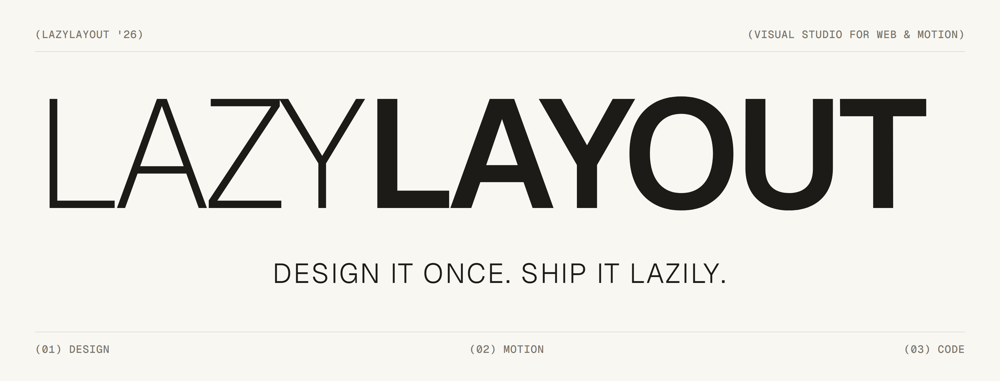

<p align="center">
  <picture>
    <source media="(prefers-color-scheme: dark)" srcset="public/readme/logo-trace-dark.svg">
    
  </picture>
</p>

<p align="center">
  <picture>
    <source media="(prefers-color-scheme: dark)" srcset="public/readme/banner-dark.png">
    
  </picture>
</p>

LazyLayout is an AI-native visual studio for building web pages and motion. You design on a canvas,
animate on a timeline, and get clean, production-grade code out: GSAP, Framer Motion, SVG and CSS
that you can drop into any codebase. No lock-in, no runtime you have to keep.

> Private repository. The editor UI is being rebuilt on the `ui/redesign` branch; this README
> describes that build and says plainly what is finished and what is not.

---

## (01) — What you get

| Mode | What it is |
| --- | --- |
| **Design** | A Figma-style canvas: frames, auto layout and grid, pen and vector tools, fills, strokes, effects, typography, sections, pages. |
| **Motion** | An After Effects-style timeline: keyframes, easing, markers, work area, onion skin, auto-key, one playback clock. |
| **Code** | The real generated project: file tree, tabs, live code that follows the document, repo export. |

Everything you do edits one document. The compiler turns that document into code, so what you see
in Code mode is what ships.

## (02) — Highlights

- **One document, three views.** Design, Motion and Code read and write the same engine, and every
  edit goes through commands, so undo and redo work everywhere.
- **Real code out.** Export a repo `.zip` (choose the files), a single file, or copy the install
  line. The Export dialog previews each file before you download.
- **Auto layout and grid on the canvas.** Drag padding and gap directly, resize grid tracks, see
  where a dragged layer will land.
- **Pen and vector.** Pen, Pencil and Anchor tools, handles, close and join, boolean operations.
- **Sections and pages.** Insert ready-made sections with live thumbnails; add, rename, reorder and
  set the home page from the Pages menu.
- **Bouncy, calm interface.** One spring system drives panels, popovers, the colour picker and the
  shared slider. A single switch ("Disable animations") turns all of it off.
- **Themes.** Paper, Graphite and more, with a cross-fade between them.
- **Command palette.** Ctrl+K reaches every command, including Export.

## (03) — Quick start

```bash
npm install
npm run dev
```

Open <http://localhost:3000> for the home page and <http://localhost:3000/editor> for the studio. The
previous editor is still available at `/editor/legacy`.

This project runs on Next.js 16 and React 19, which have breaking changes from earlier versions.
Read `AGENTS.md` before changing framework-level code.

## (04) — Scripts

| Command | What it does |
| --- | --- |
| `npm run dev` | Start the dev server |
| `npm run build` | Production build |
| `npm run start` | Serve the production build |
| `npm run typecheck` | `tsc --noEmit` |
| `npm run lint` | ESLint (warning budget enforced) |
| `npm run test` | Typecheck and unit tests |
| `npm run test:unit` | Unit tests only (`src/**/__tests__/*.test.ts`) |
| `npm run test:e2e` | Playwright end-to-end tests |
| `npm run test:canvas-contract` | Canvas, device-view and anchor suites (Chromium) |
| `npm run export-harness` | Build the export-harness fixtures under `tests/export-harness/` |

## (05) — How it is built

```
src/core            the engine: document model, commands, stores, templates (no DOM access)
src/compiler        document -> code (React, CSS, motion)
src/runtime         what the exported code runs on
src/ai              the co-pilot
src/editor          the new editor UI (Design, Motion, Code)
src/legacy-editor   the previous editor, kept at /editor/legacy
src/app             Next.js routes (home, /editor, /design-system)
tests/e2e           Playwright specs
DOCS                product, roadmap, audit, UI rules, handoffs
```

The UI follows the HTML prototype `DOCS/UI/design/editor-design-mode-blocks-dark.html`. Components
live in `src/editor/components` and are shown on the `/design-system` page. UI rules:
`DOCS/UI/UI_RULES.md` and `DOCS/UI/WORKER_RULES.md`.

The full-vision product (logic blueprints, database studio, deployment, plugins, collaboration) is
gated behind the `edition` flag (`src/core/flags.ts`) and does not ship in the current bundle.

## (06) — Status

Honest list, as of this build. Checked means built, wired to the engine and exercised in a headless
browser at 1440 px. Full details: `DOCS/UI/PROGRESS.md`.

**Built and checked**
- Shell: top bar, Pages menu, Layers tree, toolbar and Insert box, canvas settings, Spotlight, themes.
- Design: selection and transform overlay, Position, Layout, Appearance, Fill, Stroke, Effects,
  Typography, States, Page, Theme & Tokens, Vector and the other inspector sections; auto layout
  and grid; pen and vector; Export dialog.
- Motion: add keyframe, split, easing, markers, layer flags, playback, undo and redo.
- Code: real compiled files and Export.

**Open**
- Console and Trace show sample data until the runtime provides a trace.
- The Code inspector's Framework, Styling and Animation choices need compiler options.
- Pen point type, Round and Join have no engine command yet (see `DOCS/UI/INTEGRATION.md`).
- Page share image has no engine field yet.
- Some e2e specs are skipped (`test.fixme`) for features the new editor does not have yet; see `DOCS/UI/handoffs/2026-11-12-e2e.md`.
- At 390 px the side panels are hidden by design; 1024 px is checked.

**Not designed yet**
- Breakpoint bar and device views, Tokens panel, Components and variants, Graph editor, Agent pairing.

## (07) — Documentation

| Where | What |
| --- | --- |
| `DOCS/INITIAL/ROADMAP.md` | What is built and what is next |
| `DOCS/INITIAL/AUDIT.md` | Known gaps |
| `DOCS/UI/PROGRESS.md` | Editor UI progress and open items |
| `DOCS/UI/INTEGRATION.md` | Engine changes the UI is waiting for |
| `DOCS/UI/handoffs/` | One note per piece of UI work |
| `DOCS/TEAM/COLLABORATION.md` | How we work together: lanes, branches, PRs |
| `DOCS/FUTURE/` | The full-vision track (not the active roadmap) |

## (08) — Contributing

`main` changes only through pull requests with green CI. Work on a branch, never push to `main`.
Read `DOCS/TEAM/COLLABORATION.md` first. Do not add `Co-Authored-By` trailers to commits or PRs in
this repo.
